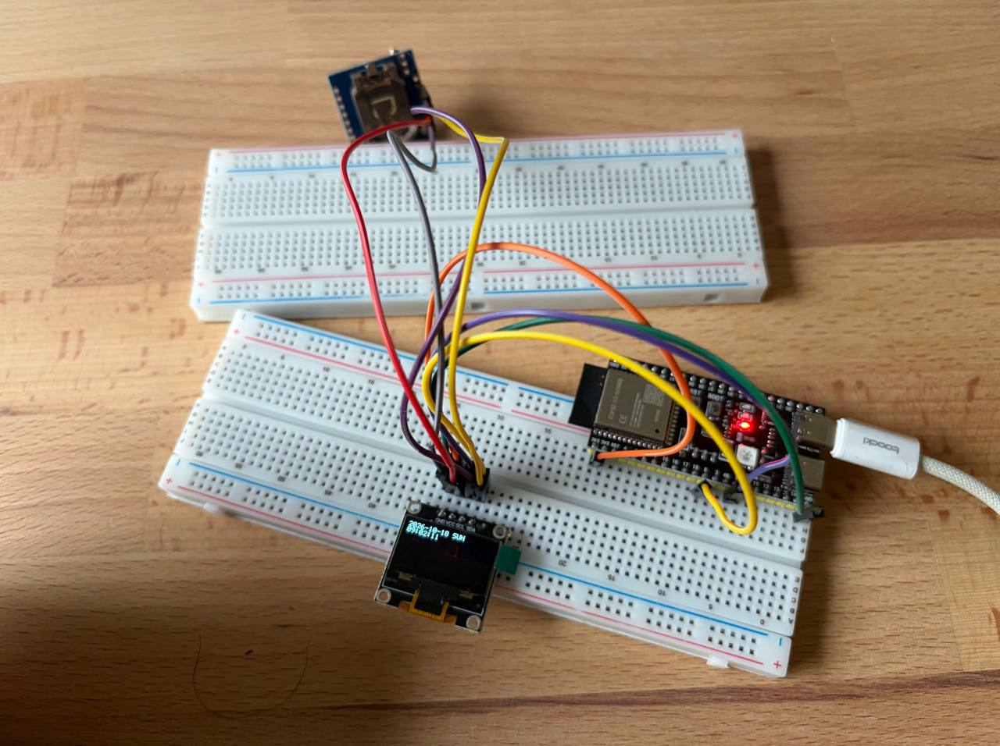

# HW4.3: Readign and displaying time from DS1307

This project reads the date and time from a DS1307 RTC over I2C and shows them on an SSD1306 OLED. The chip is re-stamped to 09:00 18.10.2026 on every boot.

## Setup

## Demo

https://github.com/user-attachments/assets/d878149f-507b-41c3-b026-b3931d8b259e

