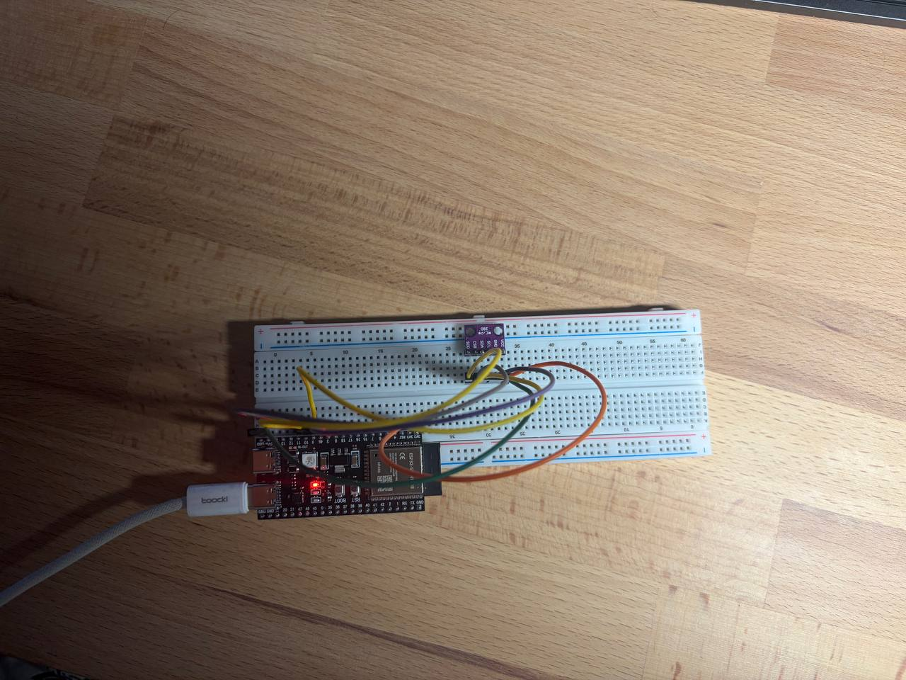

# HW4.4: Reading data from SPI - BMP280

This project reads temperature and pressure from a BMP280 over SPI and prints them to the log once a second. The sensor does the measuring on its own (normal mode), the ESP32-S3 only picks up the latest sample.

## Wiring

| BMP280 | ESP32-S3 | SPI name |
| ------ | -------- | -------- |
| SCL    | GPIO8    | SCLK     |
| SDA    | GPIO9    | MOSI     |
| SDO    | GPIO10   | MISO     |
| CSB    | GPIO11   | CS       |

1 MHz, mode 0 (CPOL=0, CPHA=0), SPI2 host.

## Setup

